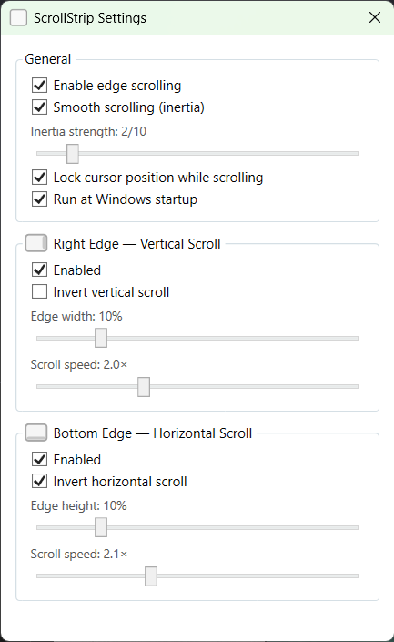
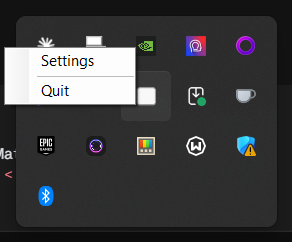

# ScrollStrip

Edge-scroll for Windows precision touchpads — swipe along the left, right, top or bottom edge with one finger to scroll, just like on a trackpad in Ubuntu with the edge scroll turned on.

> **Why?** Windows only supports edge scrolling for legacy (non-precision) touchpads via a driver shim. Modern precision touchpads expose a raw HID interface with no built-in edge-scroll support. ScrollStrip fills that gap without touching driver settings.

<table>
  <tr>
    <td valign="top">
      
    </td>
    <td valign="top">
      
    </td>
  </tr>
</table>

---

## Features

- **Left/right/top-edge vertical scroll** — start one finger along either side or the top edge to scroll up/down
- **Bottom-edge horizontal scroll** — drag along the bottom edge to scroll left/right
- **Momentum / inertia** — flick and the page keeps coasting; adjustable strength (1–10)
- **Adjustable edge zones** — configure how wide/tall each trigger zone is (5–30 % of the touchpad)
- **Per-axis speed multiplier** — independent speed control for vertical and horizontal
- **Invert scroll direction** — per axis
- **Cursor lock** — optionally locks the pointer in place while scrolling so it doesn't drift
- **Run at startup** — registers itself in `HKCU\...\Run` on request
- **Lives in the system tray** — no taskbar entry, double-click or right-click → Settings to configure

---

## Requirements

| Requirement | Details |
|---|---|
| OS | Windows 10 (1903+) or Windows 11 |
| Touchpad | Any **precision touchpad** (HID Digitizer, Usage Page 0x0D / Usage 0x05) |
| Runtime | [.NET 8 Desktop Runtime](https://dotnet.microsoft.com/download/dotnet/8.0) — only needed for the framework-dependent build |

> **Check if your touchpad is a precision touchpad:** Settings → Bluetooth & devices → Touchpad. If you see "Your PC has a precision touchpad" it's supported.

---

## Installation

### Pre-built release

1. Download `ScrollStrip.exe` from the [Releases](../../releases) page.
2. Run it — a small icon appears in the system tray.
3. Right-click the tray icon → **Settings** to configure.

ScrollStrip needs no installation and writes no registry keys except the optional run-at-startup entry.

### Build from source

```
git clone https://github.com/tasos14/ScrollStrip.git
cd ScrollStrip
dotnet run
```

To publish this customized build with its runtime and WPF dependencies:

```
dotnet publish -c Release -o publish
```

Run `publish\ScrollStrip.exe` and keep the whole publish folder together. This build
keeps native WPF libraries beside the executable instead of extracting them to a
temporary cache. `--settings` opens Settings. A second launch opens Settings in the
existing process, so only one instance scrolls at a time.

---

## Usage

| Action | Result |
|---|---|
| One finger on the **left or right edge**, drag up/down | Vertical scroll |
| One finger on the **top edge**, drag left/right | Vertical scroll (left = up, right = down; reverses with Invert vertical scroll) |
| One finger on the **bottom edge**, drag left/right | Horizontal scroll |
| Flick and lift | Inertia coast |
| Touch during inertia coast | Stops inertia |
| Two fingers anywhere | Passthrough — normal two-finger gesture, no interference |
| Double-click tray icon | Opens Settings |
| Right-click tray icon → Quit | Exits |

Taps in the edge zone are intentionally ignored — a deliberate scroll gesture must travel at least ~2 mm before any scroll event is sent.

---

## Settings

All settings are saved automatically to `%AppData%\ScrollStrip\settings.json`.

### General

| Setting | Default | Description |
|---|---|---|
| Enable edge scrolling | ✓ | Master on/off switch |
| Smooth scrolling (inertia) | ✓ | Momentum after lifting the finger |
| Inertia strength | 5 | 1 (snappy, ~600 ms) → 10 (long coast, ~5 s) |
| Lock cursor while scrolling | ✓ | Prevents the pointer drifting as you drag the edge |
| Run at Windows startup | ✗ | Adds/removes a registry entry under `HKCU\...\Run` |

## How it works

ScrollStrip creates a hidden message-only window and registers for **Raw Input** (`WM_INPUT`) on the precision touchpad HID device (Usage Page `0x0D`, Usage `0x05`). It never intercepts normal input — two-finger gestures, taps, and clicks all reach Windows as usual.

Each raw report is parsed using the Windows HID preparsed-data API (`HidP_GetValueCaps`, `HidP_GetUsageValue`, `HidP_GetUsages`) to extract per-finger contact IDs, normalised X/Y coordinates, and tip-switch state — without ever opening the device file.

When a single finger lands inside a configured edge zone, ScrollStrip tracks its movement and synthesises scroll events via `SendInput` (`MOUSEEVENTF_WHEEL` / `MOUSEEVENTF_HWHEEL`). Scroll amounts are sent as proportional integers each HID event, giving smooth sub-notch scrolling that works in every modern app.

On finger lift, a **100 ms velocity buffer** produces a launch velocity. A 16 ms timer then applies exponential decay to coast the page to a stop, mimicking the feel of native two-finger inertia.

Two edge cases are explicitly handled:

- **Phantom multi-touch** — precision touchpad hardware briefly reports a second finger contact within ~20 ms of lift. A 50 ms grace period prevents these from cancelling freshly started inertia.
- **Tap suppression** — a tap in the edge zone produces tiny HID deltas. Scrolling only begins after cumulative finger travel exceeds 2 % of the touchpad (≈ 2 mm), so taps are silently ignored.

## Local customization

Left and right edges are enabled by default, with independent enable switches. Both share the edge width, vertical speed, direction and inertia settings. Side edges take priority at bottom corners. Existing settings files remain compatible.

The top edge also supports vertical scrolling and is enabled by default. Its height can be adjusted independently (5–30%, default 10%). Once started, the gesture continues outside the initial zone until lift. All three vertical edges share direction and inertia settings; top speed is independent.

Top-edge horizontal motion controls the vertical wheel, with independent top speed and shared vertical invert and inertia. The top edge takes priority at top corners; side edges elsewhere use vertical motion. The chosen motion axis remains fixed until lift.

Top scroll speed defaults to 3.0 (range 0.5–10.0), twice the previous default. Side scroll speed keeps the existing VerticalScrollSpeedMultiplier setting; changing either speed does not affect the other.
